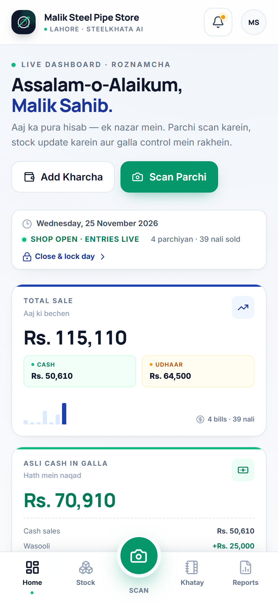
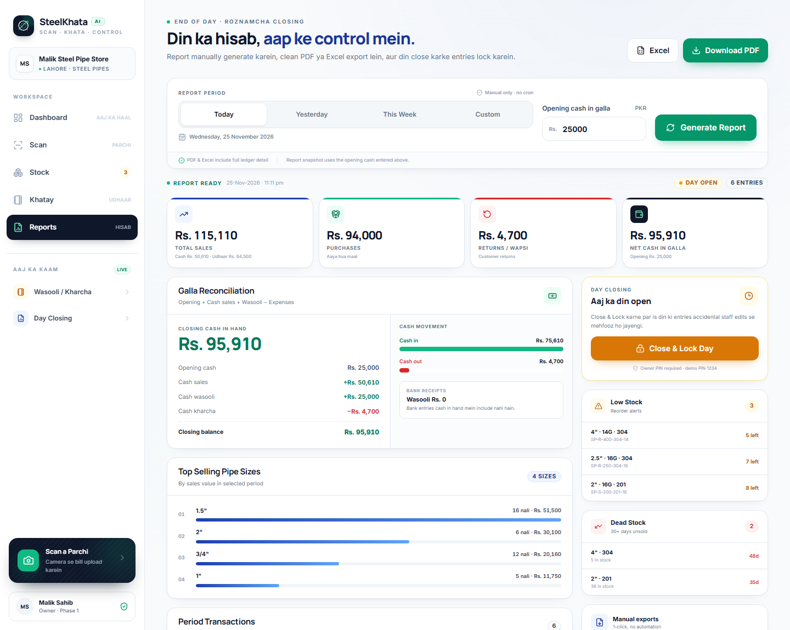
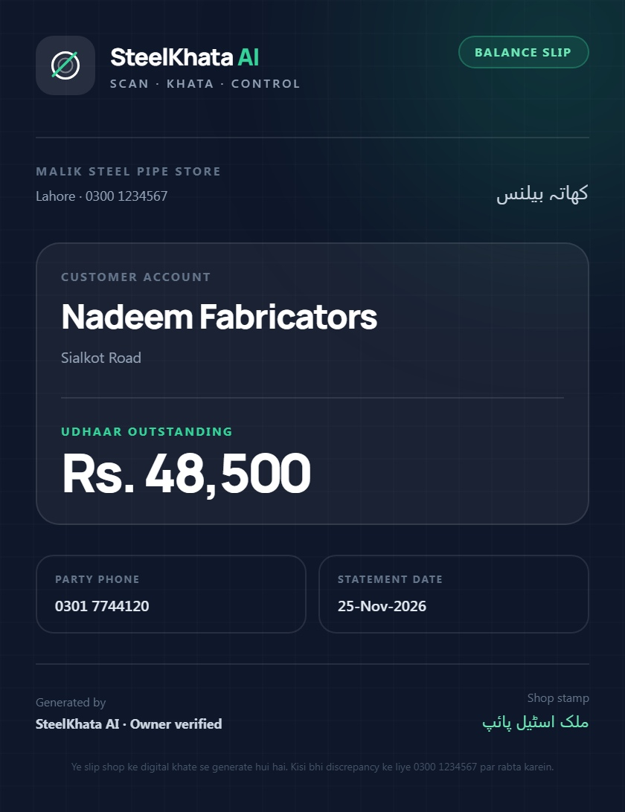

# SteelKhata AI

**Camera-first khata, stock and EOD closing for Pakistani stainless steel pipe stores.**

SteelKhata AI is a mobile-first PWA built for the real workflow of a steel pipe shop: the munshi writes a handwritten _katchi parchi_, the owner snaps a photo, and the app turns it into stock movements, customer khata, cash reconciliation and a clean closing report.

The interface is deliberately quiet — high contrast, large touch targets, tabular numbers, Roman Urdu hints and no accounting clutter.

> **Phase 1 constraint:** no n8n, no WhatsApp Cloud API and no background cron jobs. Every report and export is triggered manually by a 1-click button. The database schema has no schedulers.

---

## Preview

| Dashboard — desktop | Dashboard — mobile |
| --- | --- |
|  |  |

| Khatay ledger | EOD report |
| --- | --- |
|  |  |




---

## Quick start

```bash
npm install
cp .env.example .env.local
npm run dev
```

Open **http://localhost:3000** (or the port shown by Next.js).

The app works immediately without any API keys:

- a realistic **demo workspace** is seeded on first load (15 stainless steel SKUs, 5 fabricator khatay, 1 supplier, bills, wasooli and expenses),
- the scanner uses a **realistic fallback parser** if neither OCR provider key is configured,
- data is stored locally so refreshes keep your changes.

Production build:

```bash
npm run build
npm run start
```

---

## Environment

Copy `.env.example` to `.env.local`.

| Variable | Purpose |
| --- | --- |
| `QWEN_API_KEY` | DashScope key for the primary **Qwen3.8 Flash** OCR pass. |
| `QWEN_BASE_URL` | Defaults to `https://dashscope-intl.aliyuncs.com/compatible-mode/v1`. |
| `QWEN_MODEL` | Primary model, default `qwen3.8-flash`. |
| `QWEN_ESCALATION_MODEL` | Vision escalation model, default `qwen3-vl-plus`. |
| `GLM_API_KEY` | Z.ai key for the **GLM-5.3 Flash** fallback. |
| `GLM_BASE_URL` | Defaults to `https://api.z.ai/api/paas/v4`. |
| `GLM_MODEL` | Fallback model, default `glm-5.3-flash`. |
| `OCR_TIMEOUT_MS` | Per-provider request deadline, default `28000`. |
| `NEXT_PUBLIC_SUPABASE_URL` | Supabase project URL, for the production data adapter. |
| `NEXT_PUBLIC_SUPABASE_ANON_KEY` | Supabase anon key. |
| `SUPABASE_SERVICE_ROLE_KEY` | Server-only key, if you add secure server workflows. |
| `NEXT_PUBLIC_DEMO_OWNER_PIN` | Demo PIN for Close & Lock Day, default `1234`. |

### Image compression

`lib/compressImage.ts` runs fully in the browser before any photo reaches the API or Storage:

- decodes with `createImageBitmap` (EXIF orientation aware) and falls back to ``,
- resizes the longest edge to **1280px** and never upscales smaller images,
- re-encodes to JPEG at **0.78**, then retries at **0.70** if the result is over **250 KB**,
- strips EXIF/GPS because the export is a fresh canvas,
- returns `base64DataUrl`, `base64Pure`, `mimeType`, `originalSizeKB`, `compressedSizeKB`, `width` and `height`,
- passes an already-supported raster image through if an exotic browser format cannot be decoded, so one bad photo never crashes a batch.

The scan queue shows the live `Compressed: 4.2 MB → 142 KB` readout from this helper.

### Dual OCR pipeline

`app/api/scan-bill/route.ts` delegates to `lib/ocrEngine.ts`:

1. **Qwen3.8 Flash** is called first with the catalogue/parties context, the image and `response_format: { type: "json_object" }` at temperature `0.1`.
2. If Qwen errors, times out or returns invalid/unusable JSON, **GLM-5.3 Flash** is called through its OpenAI-compatible endpoint.
3. If the first valid result has `confidence_score < 0.75` and a Qwen key exists, **qwen3-vl-plus** gets one escalation pass; the higher-confidence result wins.
4. If both providers are unavailable or fail, a realistic **`mock-fallback`** extraction is returned so the review UI always works.

The final extraction includes `model_used`, which the scanner shows alongside the confidence score. The model output is normalised server-side: product matches are validated against the live catalogue, quantities/rates are sanitised, amounts recomputed and totals checked. A provider that rejects `response_format` is retried once with the prompt-only JSON contract.

The review card shows an amber provenance warning whenever a fallback or escalation path was used. No OCR result is ever auto-saved.

---

## The five surfaces

### `/dashboard`

- Today's live **Total Sale** with Cash / Udhaar split and 7-day mini bars.
- **Asli Cash in Galla** = cash sales + cash wasooli − cash shop expenses.
- Today's **Udhaar Given**, low-stock alerts and a clickable stock watch.
- Quick action grid for sale / purchase / return scans, plus a **Quick Roznamcha** modal for kharcha or wasooli.
- Recent parchis with original scanned thumbnails, clear routing badges, and return rows marked **WAPSI · KHATA / Khata adjusted** so they are never confused with new credit.
- Galla reconciliation rail, stock watch and top udhaar.

### `/scan`

- Three scan modes: **Sales Bill**, **Purchase / Stock Register** and **Maal Wapsi**.
- Camera-first capture with gallery batch mode (1–15 photos), client-side compression with visible size readout, and a queue.
- Dual OCR review screen with the parsing model and confidence visible:
  - big **Cash Sale** vs **Customer Khata** routing toggle,
  - auto selected cash when no party is detected,
  - low-confidence fields marked soft amber,
  - editable item quantities, rates, product matches and mazdoori/loading,
  - duplicate parchi warning for the last 7 days, with explicit override,
  - save disabled until the draft is safe.
- Save updates stock and ledger atomically in the local repository and advances through a batch.

### `/stock`

- Filter by **Size**, **Gauge**, **Grade** and **Shape**.
- Search across name, SKU, size, grade and Roman Urdu aliases.
- Low-stock and dead-stock (30+ days unsold) badges.
- Stock valuation, inline product edit, add-product modal, and a shortcut to scan a stock register page.
- Responsive table → mobile cards.

### `/khatay` and `/khatay/[id]`

- Regular customers and suppliers only; the walk-in cash counter is deliberately hidden to keep the ledger clean.
- Area/Shop tag on every party to disambiguate same-name customers.
- Full chronological ledger of bills, returns, wasooli and supplier payments with running balance.
- Bill rows open the original handwritten parchi with itemized accounting.
- **Record Wasooli** adjusts the customer balance; supplier payment adjusts payable.
- **Share Slip (JPG)** renders a branded bilingual balance card with `html-to-image`; native share on touch devices, download elsewhere.

### `/reports`

- Manual date presets (Today / Yesterday / This Week / Custom), editable opening cash.
- **Generate Report** creates a snapshot, then enables **Download PDF** and **Download Excel**.
- Galla reconciliation, top pipe sizes, stock alerts, transactions, PDF and Excel exports.
- **Close & Lock Day** with an owner PIN. Locked days are guarded in the UI, and the Supabase schema mirrors the lock flag with a `day_closures` table.

PDFs and Excel files are client-side exports:
- `jspdf` + `jspdf-autotable` for the accounting sheet,
- `xlsx` for Summary / Transactions / Payments / Stock / Khatay sheets.

---

## Supabase

The complete production foundation is in [`supabase/schema.sql`](./supabase/schema.sql):

- multi-tenant tables with `business_id`,
- composite tenant-safe foreign keys,
- indexes for stock, party ledgers, duplicate parchi lookup and closing days,
- row-level security policies for every table,
- a private `parchi-images` storage bucket with owner-scoped policies,
- a seed with 15 steel SKUs across 201/304 grades, 5 customer khatay, 1 supplier and sample transactions.

### Set up

1. Create a Supabase project.
2. Create the owner auth user (Authentication → Users, or sign-up).
3. Paste `supabase/schema.sql` into the SQL Editor and run it once.
4. The seed attaches to the **oldest auth user** so RLS remains enforceable.
5. Add the project URL and anon key to `.env.local`.

The local demo uses a dedicated `localStorage` repository to make the PWA usable without credentials. For production, connect a repository adapter behind the same interfaces in `lib/store.tsx`, sign the user in, and upload compressed images to:

```
parchi-images/<business_id>/<yyyy-mm-dd>/<uuid>.jpg
```

The storage RLS policies only allow paths whose first folder segment is a business owned by the signed-in user.

---

## Design system

- **Canvas:** `#F8FAFC` — **Cards:** `#FFFFFF` + `1px #E2E8F0`
- **Ink / brand:** `#0F172A`, steel blue `#1E40AF`
- **Action:** emerald `#059669` · amber `#D97706` for udhaar · crimson `#DC2626` for outflow
- Manrope for display, Inter for UI, tabular numerals for every amount.
- Bottom mobile nav with a raised central camera scan button; desktop sidebar.
- Industrial micro-details: hairline grids, pipe cross-section glyphs, scanned-paper thumbnails, uppercase metadata and calm motion.
- PWA manifest, install shortcuts, offline shell and a runtime-cached app shell.

---

## Project structure

```text
app/
  (app)/dashboard       live shop overview
  (app)/scan            camera capture, batch queue, AI review
  (app)/stock           inventory & product editor
  (app)/khatay          customer/supplier ledger index
  (app)/khatay/[id]     ledger statement + balance slip
  (app)/reports         EOD report, PDF/Excel, day lock
  api/scan-bill         Qwen + GLM dual OCR route + mock fallback
components/
  scanner/              capture + review stages
  shared/               bill viewer, quick entry, party avatar
  ui/                   shadcn-style primitives
lib/
  analytics.ts           day/report/ledger calculations
  compressImage.ts       canvas-only 1280px / 0.78 → 0.70 compressor
  ocrEngine.ts           Qwen primary, GLM fallback, Qwen VL escalation
  demo-data.ts           live demo workspace
  exports.ts             PDF + Excel generators
  store.tsx              local-first repository
  types.ts               TypeScript data contracts
supabase/
  schema.sql             tables, indexes, RLS, storage, demo seed
public/
  icons/                 PWA icons
  sw.js                  offline shell
  offline.html
```

---

## Verification

```bash
npm run lint
npm run typecheck
npm run build
```

Verified flows in Chromium (desktop + 390 px mobile):

- no horizontal overflow on any of the five screens and no console runtime errors,
- KPI cards share equal row heights on desktop (`222px` each) with bottom-aligned footers,
- return feed rows show **WAPSI · KHATA** and **Khata adjusted**,
- a 3000px test photo compressed to 1280×853 JPEG and displayed `375 KB → 39 KB`,
- a noisy image triggered both encoder passes (`quality 0.78` then `0.70`) and still resized to 1280px,
- scan → mock OCR → review → confirm → stock/ledger update,
- dual OCR simulation: Qwen primary, GLM fallback, Qwen VL escalation on low confidence, and `mock-fallback` when both providers fail,
- balance slip JPG download (125 KB),
- PDF export (2 pages) and Excel export (5 sheets),
- PWA manifest, service worker registration in production.

### Demo data reset

Clear the local workspace from the browser console:

```js
localStorage.removeItem("steelkhata-ai-state-v2");
location.reload();
```

The app re-seeds the Pakistani steel store demo automatically.

---

## Production notes

- The owner PIN is intentionally a demo value (`1234`). Move lock/unlock verification to a server action or signed owner session before real shop use.
- The current Phase 1 build stores demo data locally. Supabase RLS and storage are supplied for the production adapter.
- No WhatsApp, n8n or cron integration is included. Exports are user-triggered only.
- Uploaded parchi photos are compressed in-browser to a ≤1280px JPEG (0.78, then 0.70 above 250 KB) before analysis; the bucket enforces a 10 MB image limit.
- Add telemetry and a production rate limiter for the OCR route before a public launch.
