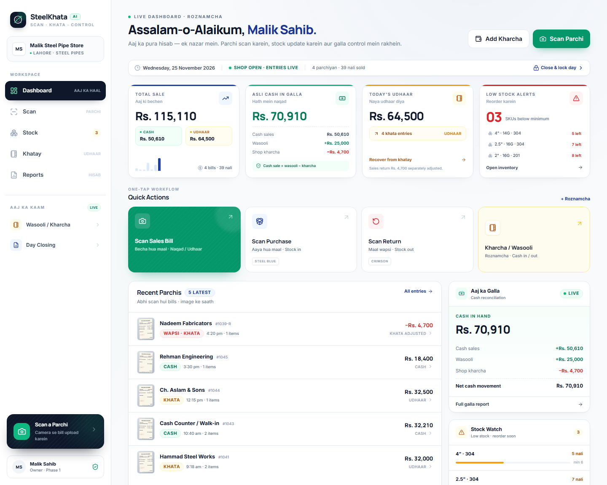
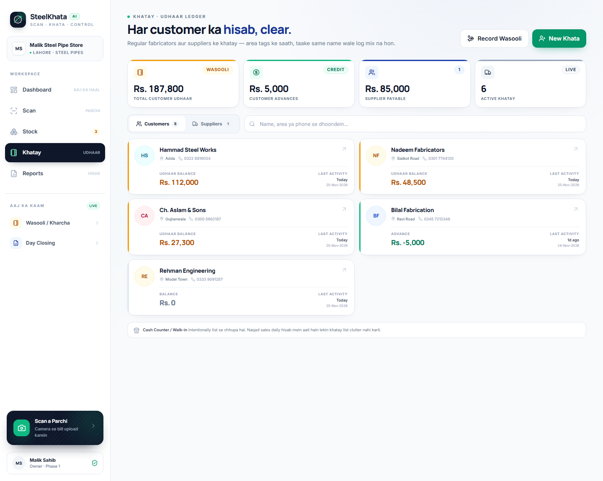
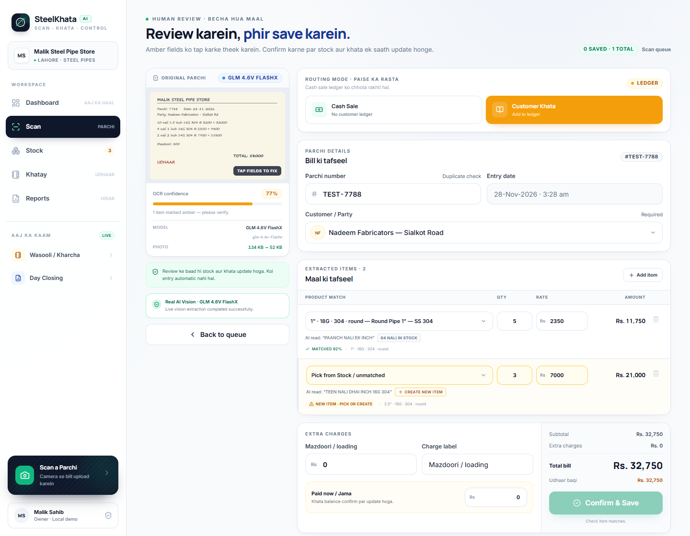
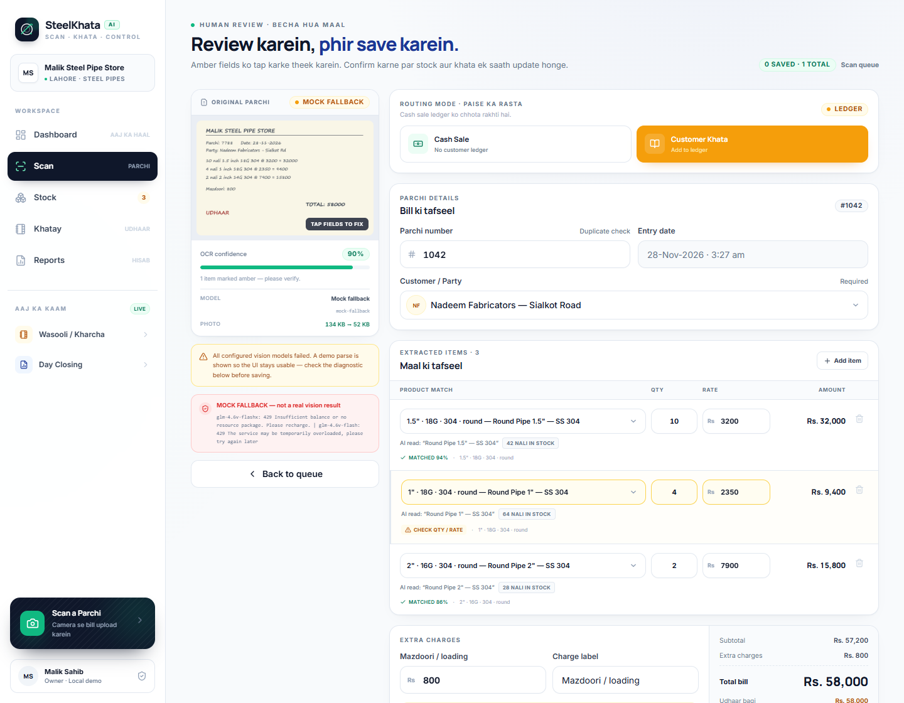
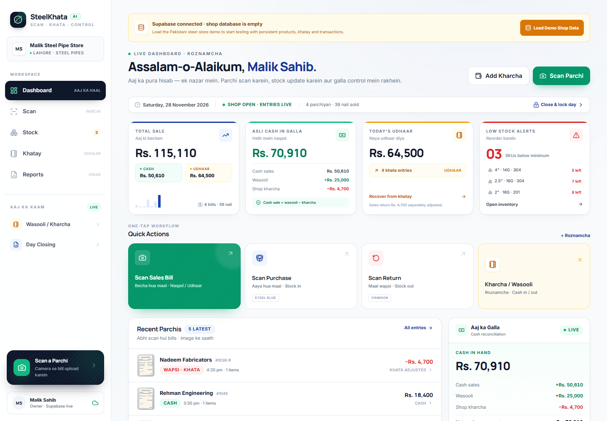

# SteelKhata AI

**Camera-first khata, stock and EOD closing for Pakistani stainless steel pipe stores.**

SteelKhata AI is a mobile-first PWA built for the real workflow of a steel pipe shop: the munshi writes a handwritten _katchi parchi_, the owner snaps a photo, and the app turns it into stock movements, customer khata, cash reconciliation and a clean closing report.

The interface is deliberately quiet — high contrast, large touch targets, tabular numbers, Roman Urdu hints and no accounting clutter.

> **Phase 1 constraint:** no n8n, no WhatsApp Cloud API and no background cron jobs. Every report and export is triggered manually by a 1-click button. The database schema has no schedulers.

---

## Preview

| Dashboard — desktop | Dashboard — mobile |
| --- | --- |
|  |  |

| Khatay ledger | EOD report |
| --- | --- |
|  |  |








---

## Quick start

```bash
npm install
cp .env.example .env.local
npm run dev
```

Open **http://localhost:3000** (or the port shown by Next.js).

The app works immediately without any API keys:

- a realistic **demo workspace** is seeded on first load (15 stainless steel SKUs, 5 fabricator khatay, 1 supplier, bills, wasooli and expenses),
- the scanner uses a **clearly labelled fallback parser** if no vision provider key is configured or every provider call fails,
- Supabase is used for live persistence when its environment variables are present; otherwise data stays in the local repository and survives refresh.

Production build:

```bash
npm run build
npm run start
```

---

## Environment

Copy `.env.example` to `.env.local`.

| Variable | Purpose |
| --- | --- |
| `GLM_API_KEY` | Z.ai key for the GLM 4.6V waterfall. |
| `GLM_BASE_URL` | Defaults to `https://api.z.ai/api/paas/v4`. |
| `GLM_FLASHX_MODEL` | Defaults to `glm-4.6v-flashx` — first, low-cost vision pass. |
| `GLM_FALLBACK_MODEL` | Defaults to `glm-4.6v-flash` — free-tier fallback with two 429 retries. |
| `GLM_ESCALATION_MODEL` | Defaults to `glm-4.6v` — only used for low-confidence results after FlashX succeeds. |
| `QWEN_API_KEY` | Alibaba DashScope key for the cross-provider backup. |
| `QWEN_BASE_URL` | Defaults to `https://dashscope-intl.aliyuncs.com/compatible-mode/v1`. |
| `QWEN_MODEL` | Defaults to `qwen-vl-plus`. |
| `OCR_TIMEOUT_MS` | Per-provider request deadline, default `30000`. |
| `NEXT_PUBLIC_SUPABASE_URL` | Supabase project URL. |
| `NEXT_PUBLIC_SUPABASE_ANON_KEY` | Anon key for the optional browser upload/auth helper. |
| `SUPABASE_SERVICE_ROLE_KEY` | **Server-only.** Used by `/api/workspace` for SQL, RLS-scoped data access and Storage uploads. |
| `STEELKHATA_BUSINESS_ID` | Optional active business UUID. Defaults to the oldest business. |
| `STEELKHATA_OWNER_ID` | Optional auth user UUID for demo seeding when no user exists. |
| `NEXT_PUBLIC_DEMO_OWNER_PIN` | Demo PIN for Close & Lock Day, default `1234`. |

### Image compression

`lib/compressImage.ts` runs fully in the browser before any photo reaches the API or Storage:

- decodes with `createImageBitmap` (EXIF orientation aware) and falls back to ``,
- resizes the longest edge to **1280px** and never upscales smaller images,
- re-encodes to JPEG at **0.78**, then retries at **0.70** if the result is over **250 KB**,
- strips EXIF/GPS because the export is a fresh canvas,
- returns `base64DataUrl`, `base64Pure`, `mimeType`, `originalSizeKB`, `compressedSizeKB`, `width` and `height`,
- passes an already-supported raster image through if an exotic browser format cannot be decoded, so one bad photo never crashes a batch.

The scan queue shows the live `Compressed: 4.2 MB → 142 KB` readout from this helper.

### Vision OCR waterfall

`app/api/scan-bill/route.ts` delegates to `lib/ocrEngine.ts`:

1. **glm-4.6v-flashx** is called first with the full product/party context, the image and `response_format: { type: "json_object" }` at temperature `0.1`.
2. If FlashX fails or times out, **glm-4.6v-flash** (free tier) is tried with up to **two retries** and a **1,500 ms** delay on HTTP **429 overload**. A 429 insufficient-balance response is terminal because retrying cannot recover it.
3. If Z.ai fails or the first usable result has `confidence_score < 0.75`, **qwen-vl-plus** is called as a cross-provider backup when `QWEN_API_KEY` is configured.
4. **glm-4.6v** is used only when the best result is still below `0.75` **and** `glm-4.6v-flashx` already succeeded, proving the account has paid balance. It is never used as an unconditional fallback.
5. If no keys are configured or every model fails, a clearly labelled **`mock-fallback`** extraction is returned.

The response includes `model_used` and, whenever an API call failed, **`debug_error`** with the exact provider error (credentials redacted). The review card shows a persistent red **MOCK FALLBACK** diagnostic rather than silently presenting sample items as a real result. The prompt explicitly tells the model to read **every handwritten line** without skipping, merging or inventing items. Each line carries a **`matched`** boolean; unmatched/new sizes are highlighted amber with **Pick from Stock** and **Create New Item** actions.

The extraction also includes `parchi_number`, `party_name`, routing/payment modes, `matched_product_id`, raw name, size/gauge/grade/shape, quantity, unit, rate, amount and confidence. A provider that rejects `response_format` is retried once with the strict prompt-only JSON contract.

### Self-learning aliases

When a scanned line is matched to a product, the raw handwritten text is appended (lowercased, deduplicated) to `products.aliases`. This happens both in the local repository and atomically inside the Supabase transaction RPC. The vector of aliases is included in every future OCR call, so the same munshi's handwriting is matched by an exact alias before fuzzy size/gauge matching is needed.

---

## The five surfaces

### `/dashboard`

- Today's live **Total Sale** with Cash / Udhaar split and 7-day mini bars.
- **Asli Cash in Galla** = cash sales + cash wasooli − cash shop expenses.
- Today's **Udhaar Given**, low-stock alerts and a clickable stock watch.
- Quick action grid for sale / purchase / return scans, plus a **Quick Roznamcha** modal for kharcha or wasooli.
- Recent parchis with original scanned thumbnails, clear routing badges, and return rows marked **WAPSI · KHATA / Khata adjusted** so they are never confused with new credit.
- Galla reconciliation rail, stock watch and top udhaar.

### `/scan`

- Three scan modes: **Sales Bill**, **Purchase / Stock Register** and **Maal Wapsi**.
- Camera-first capture with gallery batch mode (1–15 photos), client-side compression with visible size readout, and a queue.
- Vision OCR review screen with the exact `model_used`, confidence, compression size and a red diagnostic banner when a real API call failed:
  - big **Cash Sale** vs **Customer Khata** routing toggle,
  - auto selected cash when no party is detected,
  - low-confidence fields and unmatched/new items marked amber,
  - **Pick from Stock** dropdown plus **Create New Item** for unknown pipe sizes,
  - editable item quantities, rates, product matches and mazdoori/loading,
  - duplicate parchi warning for the last 7 days, with explicit override,
  - save disabled until every line has a valid product and the draft is safe.
- Save uploads the compressed image to Supabase Storage, inserts the bill and line items, updates stock/ledger atomically, and advances through a batch. Local persistence is used only when Supabase is not configured.

### `/stock`

- Filter by **Size**, **Gauge**, **Grade** and **Shape**.
- Search across name, SKU, size, grade and Roman Urdu aliases.
- Low-stock and dead-stock (30+ days unsold) badges.
- Stock valuation, inline product edit, add-product modal, and a shortcut to scan a stock register page.
- Responsive table → mobile cards.

### `/khatay` and `/khatay/[id]`

- Regular customers and suppliers only; the walk-in cash counter is deliberately hidden to keep the ledger clean.
- Area/Shop tag on every party to disambiguate same-name customers.
- Full chronological ledger of bills, returns, wasooli and supplier payments with running balance.
- Bill rows open the original handwritten parchi with itemized accounting.
- **Record Wasooli** adjusts the customer balance; supplier payment adjusts payable.
- **Share Slip (JPG)** renders a branded bilingual balance card with `html-to-image`; native share on touch devices, download elsewhere.

### `/reports`

- Manual date presets (Today / Yesterday / This Week / Custom), editable opening cash.
- **Generate Report** creates a snapshot, then enables **Download PDF** and **Download Excel**.
- Galla reconciliation, top pipe sizes, stock alerts, transactions, PDF and Excel exports.
- **Close & Lock Day** with an owner PIN. Locked days are guarded in the UI, and the Supabase schema mirrors the lock flag with a `day_closures` table.

PDFs and Excel files are client-side exports:
- `jspdf` + `jspdf-autotable` for the accounting sheet,
- `xlsx` for Summary / Transactions / Payments / Stock / Khatay sheets.

---

## Supabase

The full persistence foundation is in [`supabase/schema.sql`](./supabase/schema.sql):

- multi-tenant tables with `business_id`,
- composite tenant-safe foreign keys,
- indexes for stock, party ledgers, duplicate parchi lookup and closing days,
- row-level security policies for every table,
- a private **`bill-images`** Storage bucket with owner-scoped policies,
- atomic `record_scan_transaction` and `record_payment_entry` functions that update stock, khata balances, transaction rows and learned aliases in one PostgreSQL transaction,
- a seed with 15 steel SKUs across 201/304 grades, 5 customer khatay, 1 supplier and sample transactions.

### Set up

1. Create a Supabase project.
2. Create the owner auth user (Authentication → Users, or sign-up), or set `STEELKHATA_OWNER_ID`.
3. Paste `supabase/schema.sql` into the SQL Editor and run it once.
4. Add `NEXT_PUBLIC_SUPABASE_URL`, `NEXT_PUBLIC_SUPABASE_ANON_KEY` and the **server-only** `SUPABASE_SERVICE_ROLE_KEY` to `.env.local`.
5. Restart the app. If the database has no business yet, a **Load Demo Shop Data** banner appears automatically; it creates the demo owner/business and seeds the full shop.

The workspace API is a server-side proxy (`/api/workspace`) using the service-role client. It keeps the browser from holding the admin key. It is intentionally scoped to one active business (`STEELKHATA_BUSINESS_ID` or the oldest business). **Add an owner authentication gate before exposing this deployment publicly.**

Uploads use the private bucket at:

```
bill-images/<business_id>/<yyyy-mm-dd>/<timestamp>.jpg
```

A one-year signed URL is stored in `transactions.bill_image_url`. The read layer maps Supabase rows back into the same typed `AppState`, so Dashboard, Stock, Khatay, Reports and Scanner all read the same live workspace. If Supabase variables are absent, the PWA keeps working on its local demo repository; a cloud sync error is surfaced instead of silently overwriting data.

---

## Design system

- **Canvas:** `#F8FAFC` — **Cards:** `#FFFFFF` + `1px #E2E8F0`
- **Ink / brand:** `#0F172A`, steel blue `#1E40AF`
- **Action:** emerald `#059669` · amber `#D97706` for udhaar · crimson `#DC2626` for outflow
- Manrope for display, Inter for UI, tabular numerals for every amount.
- Bottom mobile nav with a raised central camera scan button; desktop sidebar.
- Industrial micro-details: hairline grids, pipe cross-section glyphs, scanned-paper thumbnails, uppercase metadata and calm motion.
- PWA manifest, install shortcuts, offline shell and a runtime-cached app shell.

---

## Project structure

```text
app/
  (app)/dashboard       live shop overview
  (app)/scan            camera capture, batch queue, AI review
  (app)/stock           inventory & product editor
  (app)/khatay          customer/supplier ledger index
  (app)/khatay/[id]     ledger statement + balance slip
  (app)/reports         EOD report, PDF/Excel, day lock
  api/scan-bill         Vision OCR route + diagnostic fallback
  api/workspace         Server-side Supabase workspace proxy
components/
  scanner/              capture, review, create-new-item modal
  shared/               bill viewer, quick entry, party avatar
  ui/                   shadcn-style primitives
lib/
  analytics.ts           day/report/ledger calculations
  compressImage.ts       canvas-only 1280px / 0.78 → 0.70 compressor
  ocrEngine.ts           glm-4.6v-flashx → glm-4.6v-flash → qwen-vl-plus → conditional glm-4.6v
  demo-data.ts           live demo workspace
  exports.ts             PDF + Excel generators
  store.tsx              local + Supabase repository and sync state
  types.ts               TypeScript data contracts
  supabase/
    client.ts            browser auth/upload helper
    server.ts            server-only service-role client
    workspace.ts         row mapping, seed, Storage upload, RPC writes
supabase/
  schema.sql             tables, indexes, RLS, storage, demo seed
public/
  icons/                 PWA icons
  sw.js                  offline shell
  offline.html
```

---

## Verification

```bash
npm run lint
npm run typecheck
npm run build
```

Verified flows in Chromium (desktop + 390 px mobile):

- no horizontal overflow on the five screens and no console runtime errors,
- KPI cards share equal row heights on desktop with bottom-aligned footers,
- return feed rows show **WAPSI · KHATA** and **Khata adjusted**,
- a 3000px test photo compressed to 1280×853 JPEG and displayed `375 KB → 39 KB`,
- a noisy image triggered both encoder passes (`quality 0.78` then `0.70`) and still resized to 1280px,
- real vision calls reached `glm-4.6v-flashx`; it returned 429 without balance, so the free `glm-4.6v-flash` fallback ran all three attempts (two 1,500 ms retries) and also returned 429 overload. Qwen was not configured, and the UI showed the exact `debug_error` in a red mock-fallback diagnostic,
- simulated unmatched line rendered amber with **Create New Item**; creating the product and saving stored the handwritten string in its aliases and persisted the transaction across reload,
- local fallback alias learning verified for an existing product and a newly created pipe size,
- empty Supabase workspace state rendered the **Load Demo Shop Data** banner and completed the simulated seed action,
- balance slip JPG download (125 KB), PDF export (2 pages) and Excel export (5 sheets),
- PWA manifest, service worker registration in production.

Live Supabase write verification requires project credentials and the schema to be applied; the current workspace has no Supabase URL/service key, so the app is running in its local-cache fallback.

### Demo data reset

Clear the local workspace from the browser console:

```js
localStorage.removeItem("steelkhata-ai-state-v2");
location.reload();
```

The app re-seeds the Pakistani steel store demo automatically.

---

## Production notes

- Configure Supabase with `NEXT_PUBLIC_SUPABASE_URL` and the server-only `SUPABASE_SERVICE_ROLE_KEY`; then apply [`supabase/schema.sql`](./supabase/schema.sql).
- The `/api/workspace` proxy has no user login in this build. It is scoped to one active business but must be placed behind owner authentication/authorization before a public deployment. Do not expose the service-role key to the browser.
- The owner PIN is intentionally a demo value (`1234`). Move lock/unlock verification to a server action or signed owner session before real shop use.
- If an older commit contained a vision API key in `.env.example`, rotate that key in the provider dashboard. The working copy now keeps credentials only in `.env.local`, which is ignored by Git.
- No WhatsApp, n8n or cron integration is included. Exports are user-triggered only.
- Uploaded parchi photos are compressed in-browser to a ≤1280px JPEG (0.78, then 0.70 above 250 KB) before analysis and Storage upload; the bucket enforces a 10 MB image limit.
- Add telemetry and a production rate limiter for the OCR and workspace routes before a public launch.
